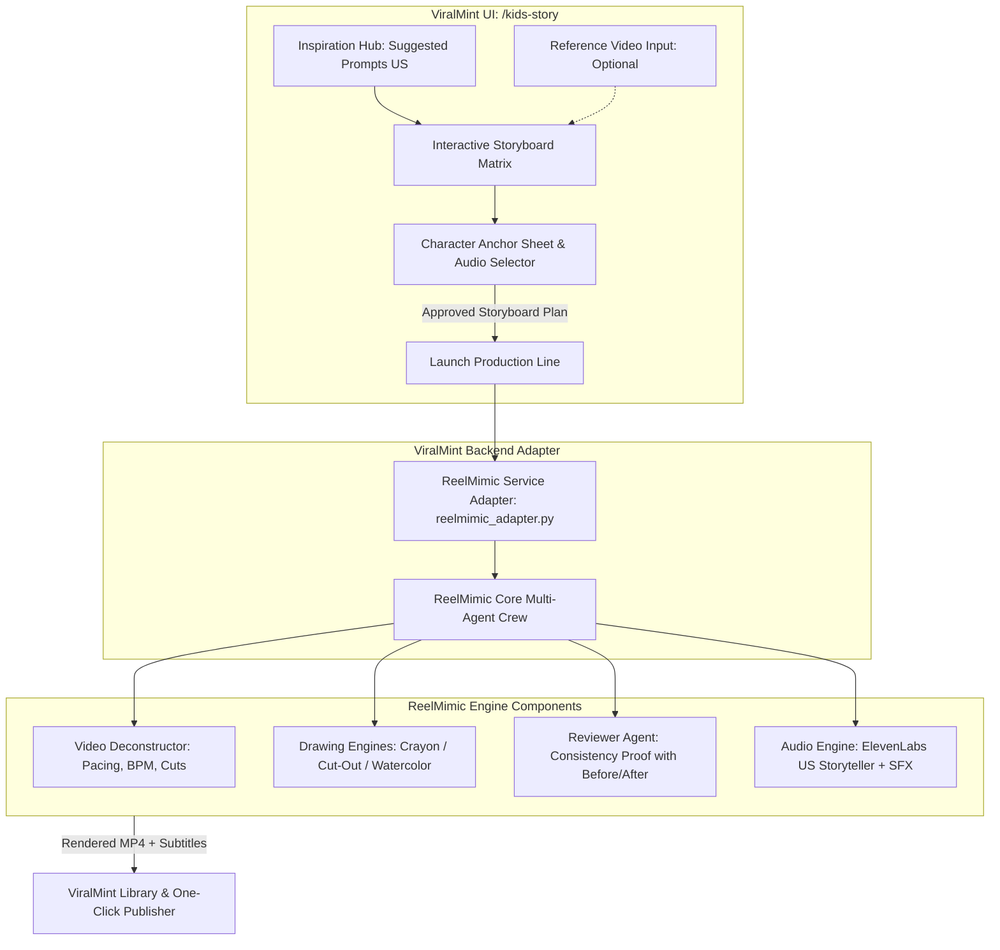

# Product Requirement Document (PRD)
## Kids Story Studio — AI 2D Story Generator Powered by ReelMimic

| Attribute | Value |
| :--- | :--- |
| **Product Name** | ViralMint — Kids Story Studio (ReelMimic Engine) |
| **Target Route** | `/kids-story` |
| **Core Dependency** | [ReelMimic](https://github.com/edenfunf/reelmimic) (2D Multi-Agent Procedural Animation) |
| **Status** | In Planning / Ready for Implementation |
| **Target Market** | US Kids Segment (YouTube Shorts, TikTok, Instagram Reels) |
| **Document Version** | 1.1.0 |
| **Date** | October 2026 |

---

## 1. Executive Summary & Objective

### 1.1 Problem Statement
Membuat konten video animasi anak-anak untuk pasar Amerika Serikat (US) memiliki tantangan teknis dan psikologis yang unik:
* **Flickering & Inkonsistensi AI:** Model AI video generatif umum sering kali merusak wajah dan karakteristik tokoh anak di tiap adegan.
* **Ritme & Retensi Khusus:** Konten anak US memerlukan formula visual yang spesifik: warna cerah hangat, transisi tenang tanpa *strobing*, dan ritme narasi berima (*rhyming*).
* **Hak Cipta & Orisinalitas:** Kreator ingin meniru keberhasilan pacing animasi viral (seperti *Bluey*, *Eric Carle*, atau *PBS Kids*), namun harus 100% bebas copyright dan memiliki karakter orisinal.

### 1.2 Solution: ViralMint + ReelMimic
Mengintegrasikan framework **[ReelMimic](https://github.com/edenfunf/reelmimic)** sebagai engine dasar studio baru **Kids Story Studio** di ViralMint.
* **ReelMimic** bertindak sebagai *underlying engine* untuk dekonstruksi video referensi, rendering 2D prosedural (*Crayon, Cut-out paper, Watercolor*), dan sistem multi-agent review yang menjaga konsistensi karakter.
* **ViralMint** menyediakan antarmuka modern (React 18), **AI Suggested Prompt Engine** (US Kids curated topics), editor storyboard interaktif, serta manajemen audio dan publishing.

---

## 2. Arsitektur Integrasi ReelMimic di ViralMint



---

## 3. Fitur Utama & Spesifikasi Fungsional

### 3.1 Feature 1: US Kids Prompt & AI Suggested Inspiration
* **Preset Kategori Terkurasi untuk Pasar US:**
  * 🛏️ **Bedtime Stories:** Cerita lembut pengantar tidur dengan irama pelan (paling dicari orang tua di US).
  * 🐾 **Animal Fables with Moral:** Kisah fabel tentang berbagi (*sharing*), kejujuran, dan empati.
  * 🦕 **Good Habits & Manners:** Kebiasaan baik anak (sikat gigi, merapikan mainan, kata ajaib *Please & Thank you*).
  * 🚀 **Silly Adventures & Rhymes:** Sajak jenaka berima ala Dr. Seuss.
  * 🌈 **Little Explorers / STEM:** Pengenalan fenomena alam secara menyenangkan.
* **Tombol `🎲 Inspire Me (US Trends)` (`/api/kids-story/inspire`):**
  * Memberikan 3–5 rekomendasi prompt instan dengan hook yang sudah diformat ramah anak.
* **Opsi Input Referensi Video (ReelMimic Powered):**
  * Pengguna bisa memasukkan link YouTube / upload video anak yang sudah terbukti populer. ReelMimic akan membedah ritme (*cut pace, BPM, framing*) untuk diadopsi ke cerita baru.

### 3.2 Feature 2: Structured Storyboard Generator
* **Story Metadata:** Judul cerita, pesan moral, dan target usia (Preschool 2–5 / Early Elementary 6–8).
* **Character Anchor Sheet (Kunci Konsistensi ReelMimic):**
  * Mendefinisikan karakter utama secara spesifik: *nama, bentuk telinga/mata, warna bulu/pakaian, aksesoris utama*.
  * Agen pemeriksa (*reviewer agent*) di ReelMimic akan menolak frame yang karakternya tidak konsisten.
* **Scene-by-Scene Cards (5–8 Adegan untuk 30–60 Detik):**
  * **Scene # & Timing:** (Contoh: *Scene 1 [0s - 4s] • The Hook*).
  * **Narration Script (US English):** Kalimat pendek, jelas, dan berima.
  * **Visual Drawing Prompt:** Deskripsi scene yang disesuaikan dengan engine gambar ReelMimic.
  * **SFX & Sound Cue:** `[soft twinkle]`, `[gentle yawn]`, `[animal giggle]`.
* **Interactive Storyboard Helper:**
  * `✨ Make it Rhyme` (Mengubah kalimat jadi bersajak otomatis).
  * `✨ Simpler Words` (Menyederhanakan diksi untuk balita).
  * `🔄 Regenerate Scene` / `➕ Add Scene` / `🗑️ Delete Scene`.

### 3.3 Feature 3: Drawing Engines ReelMimic Khusus Anak
Kids Story Studio mengadopsi 4 engine visual 2D terbaik ReelMimic yang paling disukai audiens anak US:
1. 🖍️ **Crayon Picture Book:** Gaya buku gambar krayon/pensil warna anak TK.
2. ✂️ **Paper Cut-out Stop-Motion:** Animasi potongan kertas berlapis (seperti buku karya Eric Carle).
3. 🎨 **Hand-Painted Watercolor:** Gaya dongeng klasik cat air ala Beatrix Potter (*Peter Rabbit*).
4. 📐 **Vector / Motion Graphics:** Gaya kartun modern cerah (*HyperFrames*) ala *PBS Kids*.

### 3.4 Feature 4: Audio & Multi-Agent Quality Control
* **Voiceover:** Integrasi native ElevenLabs melalui ReelMimic (`ELEVENLABS_API_KEY`) dengan preset profil:
  * *Rachel / Dorothy (Warm Storybook Narrator)*.
  * *Charlie (Playful Kid Voice)*.
* **SFX:** Auto-injection sound effect kartun via Pixabay/Freesound API.
* **Multi-Agent Review Line:**
  * Setiap shot yang selesai dirancang akan di-review oleh agen AI lain dengan tangkapan layar perbandingan (*before vs after*) untuk mencegah cacat visual sebelum digabungkan ke MP4 final.

---

## 4. Rencana UI / UX di Frontend (`/kids-story`)

Komponen utama: `frontend/src/pages/KidsStoryStudio.jsx`

### 4.1 Layout Antarmuka Dua Kolom (Two-Column Studio)

```
┌────────────────────────────────────────────────────────────────────────────────────────────┐
│ 📚 Kids Story Studio  [Powered by ReelMimic Engine]                [⚙️ Settings] [❓ Help]  │
├──────────────────────────────────────┬─────────────────────────────────────────────────────┤
│ 💡 STEP 1: PROMPT & INSPIRATION      │ 🎬 STEP 2: STORYBOARD & REELMIMIC PLAN              │
│                                      │                                                     │
│ [Preset Categories]                  │ Title: "Pip's Sleepy Cloud Journey"                 │
│ [🌙 Bedtime] [🐾 Fables] [🥦 Habits] │ Moral: It is okay to ask for a cozy rest.           │
│                                      │ Drawing Engine: [🖍️ Crayon Picture Book ▾]          │
│ Custom Story Prompt:                 │ Character: Pip the Little Cloud (Rosy cheeks, stars)│
│ ┌──────────────────────────────────┐ │                                                     │
│ │ A tiny fluffy cloud named Pip    │ │ ┌─────────────────────────────────────────────────┐ │
│ │ looking for a hill to sleep on...│ │ │ Scene 1 (0s-4s) • Hook                          │ │
│ └──────────────────────────────────┘ │ │ Narration: "Up in the sky where the starlight...│ │
│ Optional Reference Video:            │ │ Visual: Pip yawning over soft pink sunset clouds │ │
│ [ 🔗 Drop YouTube / Video Link... ]  │ │ SFX: [Soft night chime, gentle wind]            │ │
│                                      │ │ [✨ Rhyme] [🔄 Regenerate Scene] [✏️ Edit]     │ │
│ Target Age: [Preschool (2-5) ▾]      │ └─────────────────────────────────────────────────┘ │
│ [🎲 Inspire Me (US Kids Trends)]     │ ┌─────────────────────────────────────────────────┐ │
│                                      │ │ Scene 2 (4s-9s) • The Search                    │ │
│ [ 🚀 Generate Storyboard Plan ]      │ │ Visual: Pip asking a friendly sleepy bird...    │ │
│                                      │ └─────────────────────────────────────────────────┘ │
├──────────────────────────────────────┴─────────────────────────────────────────────────────┤
│ 🔊 AUDIO PRESET: Voice [ElevenLabs: Warm Storyteller ▾]   BGM [Gentle Kalimba Lullaby ▾]    │
│ [💾 Save Draft]                                     [🎬 Start ReelMimic Production Line]   │
└────────────────────────────────────────────────────────────────────────────────────────────┘
```

---

## 5. Spesifikasi Teknis & Backend Integration

### 5.1 Service Adapter: `backend/services/reelmimic_service.py`
Adapter ini menjembatani ViralMint dengan engine ReelMimic:
* Menyimpan project plan ke struktur format ReelMimic (`projects/<project_id>/plan.json`).
* Menjalankan runner ReelMimic via subprocess atau library import.
* Memantau log agen produksi secara realtime dan mengirimkan update event via **WebSocket ViralMint** (`job_started`, `job_progress`, `job_completed`).

### 5.2 Endpoint REST API (`backend/api/kids_story.py`)

| Method | Endpoint | Deskripsi |
| :--- | :--- | :--- |
| `POST` | `/api/kids-story/inspire` | Memberikan 3–5 prompt ide cerita anak US yang segar. |
| `POST` | `/api/kids-story/deconstruct-ref` | Menganalisis video referensi menggunakan video analyzer ReelMimic. |
| `POST` | `/api/kids-story/generate-storyboard` | Menghasilkan metadata cerita, profil karakter, dan kartu adegan. |
| `POST` | `/api/kids-story/refine-scene` | Memodifikasi teks atau visual scene tertentu (rhyme/simplify). |
| `POST` | `/api/kids-story/render` | Memulai render animasi 2D melalui ReelMimic Multi-Agent Pipeline. |

### 5.3 Konfigurasi Environment & Secrets (`~/.reelmimic/secrets.json` atau `.env`)
* `ELEVENLABS_API_KEY`: Untuk voiceover native American Storyteller.
* `PIXABAY_KEY` / `FREESOUND_KEY`: Untuk aset audio musik & SFX ramah anak.
* `CHROME_PATH`: Headless browser untuk rendering frame kanvas 2D.
* `CODEX_BIN` atau akses Claude Code CLI untuk agen perencana dan pemeriksa.

---

## 6. Kepatuhan Regulasi Konten Anak US (COPPA & Safety)

1. **COPPA Strict Compliance:**
   * Konten 100% bebas dari elemen kekerasan, bahasa kasar, atau jumpscare.
   * Format metadata video otomatis diberi flag `Made for Kids` saat diekspor.
2. **Visual Ergonomics for Kids:**
   * Menghindari efek lampu berkedip cepat (*no strobing effects*).
   * Palet warna lembut dan kontras ramah mata anak.

---

## 7. Roadmap Implementasi

| Tahap | Milestone | Deliverables |
| :---: | :--- | :--- |
| **Fase 1** | **Prompt & Storyboard Engine** | Backend `/inspire` & `/generate-storyboard` dengan prompt engineering anak US + pembuatan Tab UI `/kids-story`. |
| **Fase 2** | **ReelMimic Adapter Setup** | Integrasi modul `reelmimic_service.py` di backend ViralMint (setup workspace, plan schema, dan drawing engine). |
| **Fase 3** | **Audio & Quality Review Line** | Preview suara ElevenLabs langsung di storyboard card + visual feedback review agen di UI. |
| **Fase 4** | **Render Execution & Output** | Render end-to-end video animasi 30–60 detik beresolusi vertikal (9:16) dan export ke Library ViralMint. |
